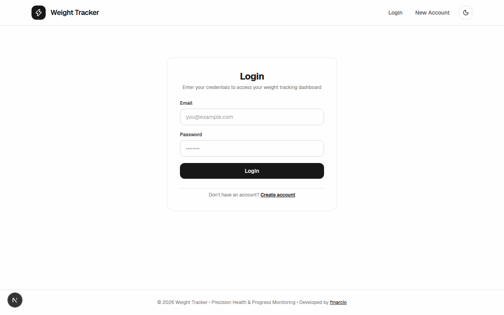

# Weight Tracker

A full-stack web application for tracking daily weight measurements, physical activity habits, and long-term progression.

Live App: [https://weight-tracker-psi-six.vercel.app/](https://weight-tracker-psi-six.vercel.app/)



## Tech Stack

- **Framework**: Next.js 16 (App Router) & React 19
- **Language**: TypeScript
- **Styling**: Tailwind CSS 4 (Light & Dark themes)
- **Backend & Auth**: Firebase Authentication & Cloud Firestore
- **Charts**: Recharts
- **Testing**: Jest & React Testing Library

## Features

- **User Authentication**: Email and password sign-up/login with per-user data isolation enforced by Firestore security rules.
- **Weight & Workout Logging**: Record daily weight (`kg`), dates, and optional exercise details.
- **History Management**: Sortable, paginated log history with inline editing, single-entry deletion, and bulk deletion.
- **Monthly Statistics (`/stats`)**: Month-over-month weigh-in comparisons, net weight change, workout consistency rate, and top exercise rankings.
- **Visual Analytics (`/charts`)**: Interactive weight progression curves (`7D`, `30D`, `90D`, `ALL`) and monthly workout vs. calendar-day bar charts.
- **Theme Support**: Persistent light and dark mode.

## Getting Started

1. **Install dependencies**
   ```bash
   npm install
   ```

2. **Configure environment variables**
   Copy `.env.example` to `.env.local` and set your Firebase project credentials:
   ```bash
   cp .env.example .env.local
   ```

3. **Start the development server**
   ```bash
   npm run dev
   ```
   Open [http://localhost:3000](http://localhost:3000) in your browser.

## Available Scripts

- `npm run dev` — Start the development server
- `npm run build` — Build for production
- `npm start` — Run the production server
- `npm test` — Run unit tests with Jest
- `npm run lint` — Run ESLint

## Project Structure

```text
weight-tracker/
├── firestore.rules         # Firestore security and schema validation rules
├── jest.config.ts          # Jest configuration
├── next.config.ts          # Next.js configuration and HTTP security headers
├── public/
│   └── demo.gif            # Application demo showcase
└── src/
    ├── __tests__/          # Unit test suites
    ├── app/                # Next.js App Router pages (/, /login, /register, /stats, /charts)
    ├── components/         # UI components, modals, stats cards, and charts
    ├── context/            # Auth and Theme context providers
    ├── hooks/              # Custom React hooks
    ├── lib/                # Firebase setup, services, and statistics utilities
    └── types/              # TypeScript interfaces
```
